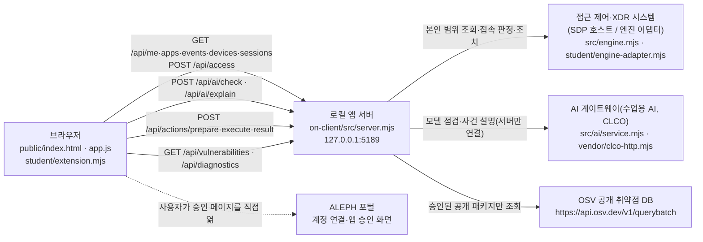

# 창고지기 실행 설명서와 시스템 구성도 (학생 작성)

이 문서는 학생이 작성했습니다. 4~6차(13~22단계) 보안 Agent **「창고지기」**를 다른 사람이 같은 위치에서 실행할 수 있게 정리했습니다.
제공 시작 틀 `alekov-starter 0.2.11`(`on-client/`)의 제공 문서(`README.md`, `docs/STUDENT_LAUNCH_GUIDE.md` 등)는 수정하지 않았습니다. 이 파일은 그 문서를 대신하지 않고, 학생이 실제로 확인한 내용과 확인하지 못한 내용을 나눠 적습니다.

- 표시 규칙: **확인함**은 학생 작업 환경(아래 1장)에서 실제로 실행해 본 것입니다. **모의 확인**은 브라우저에서 응답만 바꿔 화면을 점검한 것입니다(실제 서버 결과 아님). **미확인**은 실행하지 않았거나 실행할 수 없었던 것입니다.
- 비밀값(키·토큰·비밀번호·인증서)은 이 문서와 저장소에 적지 않습니다.

## 1. 목적·기능·지원 환경

| 항목 | 내용 |
|---|---|
| 목적 | 직원이 자기 로그인 상태, 업무 앱 접속 판정, 본인 접속 기록·XDR 경보, 기기·세션 상태, 설치 패키지 취약점 조회, AI 설명, 조치 상태를 한 화면에서 확인합니다. |
| 앱 위치 | 저장소 최상위 `choi-bujang-secret-vault/` 아래 `on-client/` 폴더(앱 폴더). Git 최상위는 `on-client`가 아니라 그 위 저장소 폴더입니다. |
| 서버 | `on-client/src/server.mjs` (Node.js 내장 모듈만 사용, 외부 npm 의존성 없음, `package-lock.json` 없음) |
| 화면 | `on-client/public/index.html`, `public/app.js`(제공), `student/extension.mjs`(학생 작성) |
| 패키지 정보 | `on-client/package.json`: 이름 `alekov-client-starter`, 버전 `0.2.11`, `engines.node` `24.19.0` |
| 수업 기준 Node.js | 24.19.0 (제공 안내 기준. 시작 도구는 22~24를 받고, 24.19.0이 아니면 「참고」 문구를 출력합니다) |
| 학생이 실제 확인한 Node.js | **v22.22.0** (Linux 작업 환경). Node 24.19.0과 Windows PowerShell에서의 실행은 **미확인** |
| 필요 프로그램 | Node.js, Git(저장소를 받을 때), 브라우저(Chrome 등) |
| 브라우저 주소 | `http://127.0.0.1:5189/` (서버는 `127.0.0.1`에서만 열립니다) |

## 2. 폴더 구조(실제 경로)

```text
choi-bujang-secret-vault/          ← Git 최상위(커밋·제출 기준)
├─ README.md                       ← 저장소 안내(1~12단계 기록 + 창고지기 요약)
├─ .gitignore                      ← .env, .env.* 제외(on-client/.env.example 만 예외로 포함)
└─ on-client/                      ← 앱 폴더(여기서 PowerShell 을 엽니다)
   ├─ package.json                 ← start / demo / check 명령
   ├─ .env.example                 ← 비밀 없는 설정 견본
   ├─ tools/start-alekov.ps1       ← 제공 실행 도구(Node 버전·폴더·포트 확인 후 서버 실행)
   ├─ src/server.mjs               ← 로컬 앱 서버(/api/*)
   ├─ src/engine.mjs, src/engine/  ← 접근 제어·기록 엔진 연결(SDP 호스트)
   ├─ src/ai/, vendor/clco-http.mjs← AI 게이트웨이(수업용 AI) 연결
   ├─ src/actions/                 ← 조치 준비·집행·결과 조회
   ├─ src/vulnerabilities/         ← package-lock.json·node_modules 대조와 OSV 조회
   ├─ public/                      ← 제공 화면(index.html, app.js, vulnerabilities-view.mjs …)
   ├─ student/extension.mjs        ← 학생 작성(13~20단계 화면 함수 8개)
   ├─ student/engine-adapter.mjs   ← 엔진 연결 어댑터(시작 틀 그대로, 학생 수정 없음)
   └─ docs/STUDENT_RUNBOOK.md      ← 이 문서
```

## 3. 실행 절차

### 3-1. PowerShell 을 여는 위치
1. 파일 탐색기에서 `…\choi-bujang-secret-vault\on-client` 폴더를 엽니다.
   - 예: `<저장소를 받은 상위 폴더>\choi-bujang-secret-vault\on-client` (`<…>` 는 각자 PC 의 실제 폴더로 바꿔 넣습니다)
2. 주소 표시줄에 `powershell` 을 입력하고 Enter 를 누릅니다.

### 3-2. 실행 명령 (`on-client` 폴더에서)

| 목적 | 명령 | 정상 시작 신호(콘솔) | 확인 |
|---|---|---|---|
| 기본 실행(제공 도구) | `powershell -NoProfile -ExecutionPolicy Bypass -File .\tools\start-alekov.ps1` | `케셰브가 켜졌습니다. 브라우저에서 http://127.0.0.1:5189/ 을 여세요.` (도구 소스 133행) | **미확인**(PowerShell 미실행, 문구는 도구 소스에서 읽음) |
| 기본 실행(npm) | `npm start` (= `node src/server.mjs`) | `케셰브 연결 확인: http://127.0.0.1:5189` | **확인함** |
| 예제 자료로 화면 보기 | `npm run demo` (= `node src/server.mjs --demo`) | `케셰브 예제: http://127.0.0.1:5189` | **확인함** |
| 학생 파일 문법 검사 | `npm run check` (= `node --check student/extension.mjs`) | 오류 없이 끝남 | **확인함** |

- 실행할 때 Node 가 `ExperimentalWarning: SQLite is an experimental feature` 를 함께 출력할 수 있습니다. 경고이며 실행은 계속됩니다(**확인함**, v22.22.0).
- `npm run demo` 의 「예제 자료」는 실제 연결이나 단계 성취가 아닙니다. 기본 실행은 회사 시스템(엔진)에 연결되지 않은 상태라 `/api/me` 가 `ENGINE_NOT_CONNECTED` 를 돌려줍니다(**확인함**).
- 포트를 바꾸려면 제공 도구는 ` -Port 5190`, npm 실행은 환경변수 `ON_PORT`(1024~65535) 를 씁니다. 범위를 벗어나면 `Error: INVALID_PORT` 로 멈춥니다(**확인함**).

### 3-3. 브라우저에서 확인
1. `http://127.0.0.1:5189/` 를 엽니다.
2. 위쪽 상태 표시와 「보호 현황」 화면이 보이면 정상입니다. 메뉴 탭은 「보호 현황」·「업무 앱」·「보안 기록」입니다(방향키·Enter 로도 이동).
3. 제목 옆에 `student/extension.mjs · render…` 태그가 붙은 칸(「학생 구현 표시」, 「학생 AI 연결 표시」 등)이 학생이 만든 화면입니다. 나머지 「제공」 태그 카드는 시작 틀 화면입니다.

### 3-4. 종료와 재실행
- 종료: 서버를 실행한 PowerShell 창에서 `Ctrl+C`. 브라우저 주소가 더 열리지 않으면 종료된 것입니다.
- 재실행: 같은 `on-client` 폴더에서 3-2 의 명령을 다시 실행합니다. 실행·종료는 파일을 바꾸지 않습니다.
- 화면 자료만 새로 받으려면 서버를 끄지 않고 화면 위쪽 「다시 불러오기」를 누릅니다(자동 재요청 없음).

### 3-5. 설정 견본(.env.example)
- 서버는 `.env` 파일을 자동으로 읽지 않고 실행한 셸의 환경변수(`ON_PORT`, `ON_ENGINE_ADAPTER`, `ON_PROJECT_DIRECTORY`, `ON_APPROVED_PUBLIC_PACKAGES`, `ON_AI_MODEL`)를 읽습니다(`src/server.mjs` 726~738행).
- `ON_PROJECT_DIRECTORY`(조회 대상 프로젝트)와 `ON_APPROVED_PUBLIC_PACKAGES`(허용 공개 패키지)는 담당자가 정합니다. 학생이 임의로 바꾸지 않습니다. 비어 있으면 패키지 조회는 `not_configured`/`not_checked` 가 정상입니다.
- 키·토큰은 문서·커밋에 넣지 않습니다. 실제 앱 신원·AI 연결은 신뢰된 호스트(담당자 안내)가 구성합니다.

## 4. 시스템 구성도

### 4-1. Mermaid



### 4-2. 같은 내용을 글(ASCII)로

```text
[브라우저]  index.html + app.js(제공) + student/extension.mjs(학생: 표시만)
    │  모든 요청은 같은 출처 http://127.0.0.1:5189 의 /api/* 로만 보냄(주소·키 입력 칸 없음)
    ▼
[로컬 앱 서버]  on-client/src/server.mjs  (127.0.0.1 에서만 열림)
    ├──► [접근 제어·XDR 시스템]  SDP 호스트 → src/engine.mjs → student/engine-adapter.mjs
    │       /api/me, /api/apps, /api/access, /api/events, /api/devices, /api/sessions, /api/actions/*
    │       연결 안 됨 = ENGINE_NOT_CONNECTED (기본 실행) · 예제 = --demo
    ├──► [AI 게이트웨이(CLCO)]  src/ai/service.mjs → vendor/clco-http.mjs
    │       /api/ai/check(연결 점검), /api/ai/explain(사건 설명)
    │       권한 준비 전 = ON_AI_PROVISIONING_PENDING
    └──► [OSV]  src/vulnerabilities/project-scan.mjs → osv.mjs (승인된 공개 패키지만)
            /api/vulnerabilities
[ALEPH 포털]  계정 연결·AI 앱 승인은 사용자가 승인 페이지를 직접 열어 처리
```

### 4-3. 표

| 출발 | 도착 | 경로/파일 | 무엇을 | 비고 |
|---|---|---|---|---|
| 브라우저 | 로컬 앱 서버 | `/api/me`, `/api/apps`, `/api/events`, `/api/devices`, `/api/sessions` (GET) | 본인 범위 자료 | 응답 형식이 틀리면 app.js 가 `CONTRACT_MISMATCH` 로 바꿈 |
| 브라우저 | 로컬 앱 서버 | `/api/access` (POST) | 선택한 업무 앱 하나의 접속 판정 | 자동 재시도 없음 |
| 브라우저 | 로컬 앱 서버 | `/api/ai/check`, `/api/ai/explain` (POST) | AI 연결 점검·사건 설명 | 브라우저는 AI 게이트에 직접 연결하지 않음 |
| 브라우저 | 로컬 앱 서버 | `/api/actions/prepare`, `/execute`, `/result` (POST) | 조치 준비·사람 확인 후 집행·결과 재조회 | 확인 티켓은 제공 화면 메모리에만 있음 |
| 브라우저 | 로컬 앱 서버 | `/api/vulnerabilities`, `/api/diagnostics` (GET) | 설치 패키지 조회·도움정보 | 사용자가 버튼을 누를 때만 |
| 로컬 앱 서버 | 접근 제어·XDR | `src/engine.mjs`, `src/engine/sdp-host.mjs`, `student/engine-adapter.mjs` | 조회·판정·조치 | 실제 연결은 담당자 설정 필요(**미확인**) |
| 로컬 앱 서버 | AI 게이트웨이 | `src/ai/service.mjs`, `vendor/clco-http.mjs` | 모델 점검·설명 | 실제 연결은 운영 측 권한 필요(**미확인**) |
| 로컬 앱 서버 | OSV | `src/vulnerabilities/osv.mjs` | 알려진 취약점 조회 | 허용 목록이 비면 외부 조회 안 함 |

## 5. 제공 코드와 학생 작성 부분의 경계

| 구분 | 파일 | 누가 | 학생 수정 |
|---|---|---|---|
| 서버·엔진·AI·조치·취약점 조회 | `on-client/src/**`, `vendor/**`, `tools/**` | 제공 | 안 함 |
| 화면 뼈대·제공 카드·버튼·검증 | `on-client/public/**` (`app.js`, `vulnerabilities-view.mjs` 등) | 제공 | 안 함 |
| 엔진 어댑터 | `on-client/student/engine-adapter.mjs` | 제공 | 안 함 |
| 학생 표시 함수 | `on-client/student/extension.mjs` | **학생** | 13~20단계에서 작성 |
| 학생 문서 | `on-client/docs/STUDENT_RUNBOOK.md`, 저장소 `README.md` 의 창고지기 절 | **학생** | 21단계에서 작성 |

학생 함수는 모두 `createStudentView()` 가 돌려주며, 제공 화면이 상태가 바뀔 때마다 호출합니다. 학생 코드는 요청을 보내거나 버튼으로 조치를 실행하지 않고, `document.createElement` 와 `textContent` 로 받은 상태만 그립니다.

| 단계 | 학생 함수 | 하는 일 | 확인 |
|---|---|---|---|
| 13 | `renderIdentity` | 사용자·현재 기기·세션과 목록. 불러오는 중·연결 실패·확인 불가 구분 | 확인함(데모) |
| 14 | `renderDecision` | 허용(allow)·거부(deny)·추가 확인 필요(challenge)·확인 불가(unknown) + 이유·시각. 요청 실패는 거부가 아님 | 확인함(데모 3종) + 모의 확인(unknown·형식 오류) |
| 15 | `renderEvents` | 최신순 기록, 필터 3개(기록 종류·업무 앱·접속 상태), 「<id> 상세」 | 확인함(데모 1건) + 모의 확인(여러 건·빈 목록·실패) |
| 16 | `renderStatus` | 기기·세션·알림·도움정보, 「도움정보 복사」, 상세의 「<action> 미지원」 비활성 버튼 | 확인함(데모) + 모의 확인(실패·빈 목록) |
| 17 | `renderAiConnection` | AI 연결 점검 전·중·결과(test/verified)·원인별 오류 | 확인함(데모: 권한 준비 중) + 모의 확인(성공·오류 8종) |
| 18 | `renderExplanation` | AI 설명을 근거·규칙·확인 불가 상태·제안과 연결. 근거 불일치·실행됨 응답 거부 | 모의 확인(실제 설명 성공은 미확인) |
| 19 | `renderAction` | 준비됨·전달 중·접수(ACK)·효과 확인·결과 불명 구분 | 확인함(데모: idle) + 모의 확인(준비→접수→효과·결과 불명) |
| 20 | `renderVulnerabilities` | 정확한 설치 버전·OSV 결과·미조회·일부 실패 구분 | 확인함(데모: not_configured) + 모의 확인(partial 등) |

## 6. 오류별 확인 순서

| 화면·콘솔에 보이는 것 | 뜻 | 확인 순서 | 복구 |
|---|---|---|---|
| `Error: listen EADDRINUSE: address already in use 127.0.0.1:5189` (npm 실행, **확인함**) / 「포트 5189 를 다른 프로그램이 쓰고 있습니다」(제공 도구) | 포트가 이미 사용 중 | 이미 켜 둔 창이 있는지 봅니다 | 그 창에서 `Ctrl+C` 로 끄거나, 다른 포트(`-Port 5190` / `ON_PORT=5190`)로 실행하고 주소도 바꿉니다 |
| `Error: INVALID_PORT` (**확인함**) | 포트 값이 1024~65535 밖 | `ON_PORT` 값을 확인 | 범위 안 숫자로 다시 실행 |
| 「앱 폴더가 아닙니다」/「시작 틀 폴더가 아닙니다」(제공 도구) | `on-client` 밖에서 실행 | PowerShell 위치 확인 | 3-1 위치에서 다시 실행 |
| `ENGINE_NOT_CONNECTED` · 데이터 출처 「연결 없음」(**확인함**) | 접근 제어·XDR 시스템 미연결(기본 실행) | 도움정보의 engine.mode·engine.code 확인 | 연결은 담당자 안내. 화면만 볼 때는 `npm run demo` |
| 학생 칸 「연결 실패: …」·「요청 실패: …」 | 서버가 꺼졌거나 응답 없음 | 서버 창이 켜져 있는지 확인 | 서버를 다시 켠 뒤 「다시 불러오기」를 직접 누름 |
| 「확인 불가: …」(`CONTRACT_MISMATCH`) | 응답 형식을 확인할 수 없음 | 이전 목록을 정상으로 보지 않음 | 「다시 불러오기」, 반복되면 도움정보를 담당자에게 |
| 「시간 초과(…)」(`TIMEOUT`) | 10초 안에 응답 없음 | 서버·네트워크 상태 | 잠시 뒤 직접 다시 요청 |
| AI 「권한 준비 중·확인 불가」(`ON_AI_PROVISIONING_PENDING`, 데모에서 **확인함**) | 운영 측 계정·앱 권한 준비 전 | 학생 잘못 아님 | 담당자에게 계정 연결·앱 권한 확인 요청 |
| AI 「인증 실패」·「접근 제한」·「사용량·이용 한도」·「이용 시간 아님」·「모델 없음」 | 코드별 원인(`WB_CLCO_*`, `ON_AI_MODEL_LIST_EMPTY`) | 학생 칸의 오류 코드 확인 | 학생 칸 안내대로(계정 연결 재확인·담당자 확인·이용 시간 확인) |
| 패키지 조회 「조회 준비 미완료(not_configured)」(데모에서 **확인함**) / 「아직 조회 안 함(not_checked)」 | 조회 대상·허용 패키지 미설정 | 「취약점 없음」이 아님 | 담당자가 설정. 학생이 임의 변경하지 않음 |
| 조치 「결과 불명(unknown)」 | 전달 뒤 결과 확인 불가 | 성공·효과 없음으로 판단 금지 | 「원천 결과만 재조회」를 직접 누름. 다시 집행하지 않음 |
| 학생 칸 「학생 구현 … 실행 중 오류」 | `extension.mjs` 예외 | `npm run check` 로 문법 확인 | 첫 오류 줄을 근거로 한 가지만 고침 |

자세한 오류 코드표는 제공 문서 `on-client/docs/CONNECTION_TROUBLESHOOT.md` 를 봅니다.

## 7. 확인하지 않은 것(미확인)

| 항목 | 이유 |
|---|---|
| Windows PowerShell 에서 `tools\start-alekov.ps1` 실행과 그 출력 문구 | 학생 작업 환경에서 실행하지 않음(문구는 소스에서 읽음) |
| Node.js 24.19.0 에서의 실행 | v22.22.0 으로만 실행해 봄 |
| 실제 접근 제어·XDR 시스템(SDP 호스트) 연결 | 담당자 설정 필요 |
| 실제 수업용 AI 연결 성공·사건 설명 성공 | 운영 측 권한 필요, 유료 요청이라 반복하지 않음(17단계 판정은 권장일 이후 통과로 기록됨) |
| 실제 조치 집행·효과 관측 | 연동 시스템 미준비, 실제 집행은 시험하지 않음 |
| 실제 package-lock.json 대상 OSV 조회와 버전 대조 | 조회 대상·허용 패키지 미설정 |
| 다른 사람 PC 에서 이 문서대로 처음부터 실행 | 아직 해 보지 않음 |
